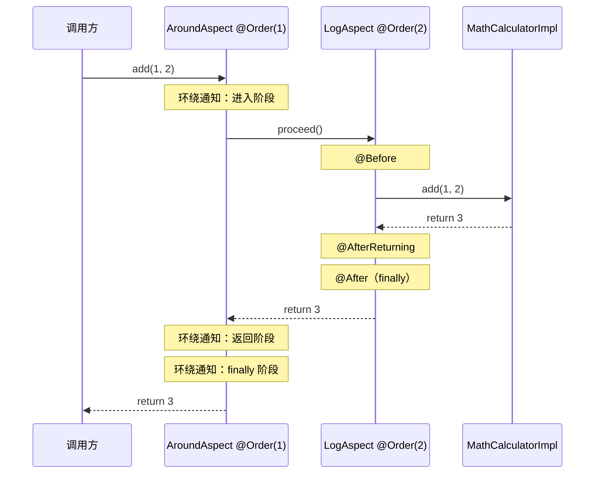
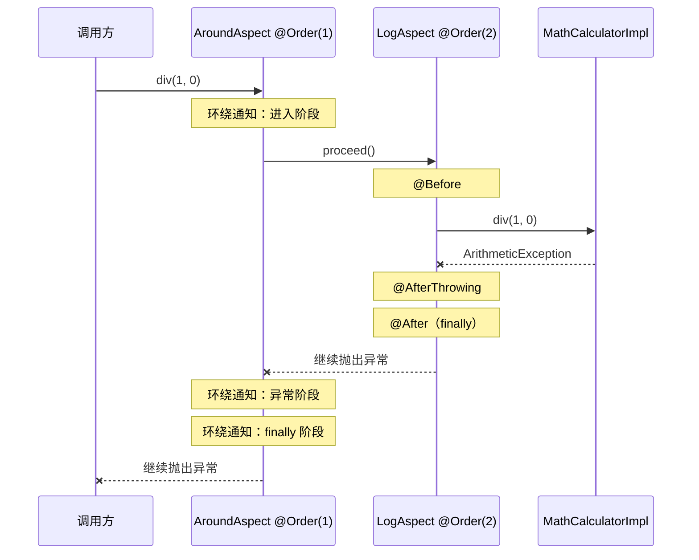

# Spring AOP 学习笔记

本文结合 `aspect/LogAspect.java`、`aspect/AroundAspect.java`、`AopTest.java` 和当前计算器示例整理，重点说明 Spring AOP 的核心概念、通知类型、切点表达式、多切面调用顺序、代理限制以及常见应用场景。

## 1. AOP 是什么

AOP（Aspect-Oriented Programming，面向切面编程）用于抽取分散在多个业务类中的横切逻辑，例如日志、权限、事务、缓存和监控。

如果不使用 AOP，每个业务方法可能都要手动编写相同逻辑：

```java
检查权限();
记录开始时间();
try {
    执行业务();
    记录成功日志();
} catch (Exception e) {
    记录异常日志();
    throw e;
} finally {
    清理上下文();
}
```

使用 AOP 后，业务类只保留核心业务，公共逻辑由代理对象在方法调用前后统一执行：

```text
调用方 -> Spring 代理对象 -> 增强器链 -> 目标对象
```

Spring AOP 基于运行时代理，默认不会修改目标类的字节码。它只支持方法执行连接点；如果要拦截构造器、字段读写等连接点，需要使用完整的 AspectJ 编织能力。

## 2. AOP 核心术语

| 术语 | 含义 | 当前项目中的例子 |
| --- | --- | --- |
| Aspect（切面） | 组织横切逻辑的类 | `LogAspect`、`AroundAspect` |
| Join point（连接点） | 可以被增强的位置 | `MathCalculator` 的方法执行 |
| Pointcut（切点） | 从连接点中筛选目标的规则 | `execution(int ...*(int, int))` |
| Advice（通知） | 命中切点后执行的增强代码 | `logStart()`、`aroundAdvice()` |
| Target（目标对象） | 真正包含业务逻辑的对象 | `MathCalculatorImpl` |
| Proxy（代理对象） | 包装目标对象并执行增强器链的对象 | 注入 `AopTest` 的 `mathCalculator` |
| Weaving（织入） | 把切面应用到目标的过程 | Spring 创建代理并组织增强器链 |

### 切面、通知和切点的关系

```text
切面 Aspect
├── 切点 Pointcut：决定“在哪里执行”
└── 通知 Advice：决定“何时执行、执行什么”
```

## 3. 当前两个切面分别做了什么

### 3.1 LogAspect

`LogAspect` 使用四种普通通知记录方法执行过程：

```java
@Before("pointCut()")
@After("pointCut()")
@AfterReturning(value = "pointCut()", returning = "result")
@AfterThrowing(value = "pointCut()", throwing = "e")
```

它们的语义分别是：

| 通知 | 执行时机 | 注意点 |
| --- | --- | --- |
| `@Before` | 目标方法执行前 | 适合日志、校验；主动抛异常可以阻止后续执行 |
| `@AfterReturning` | 目标方法正常返回后 | 可以读取返回值；普通返回通知不用于替换返回值 |
| `@AfterThrowing` | 目标方法抛出且异常继续向外传播时 | 目标方法内部吞掉异常时不会触发 |
| `@After` | 正常或异常都会执行 | 类似 `finally`，执行它不代表业务成功 |

当前命名切点：

```java
execution(int com.example.springaop.calculator.MathCalculator.*(int, int))
```

它表示：

- 返回值必须为 `int`；
- 声明类型是 `MathCalculator`；
- 方法名任意；
- 参数必须是两个 `int`。

因此会匹配当前接口中的 `add`、`sub`、`mul` 和 `div`。

`JoinPoint` 封装了本次调用的信息：

```java
joinPoint.getSignature(); // 方法签名
joinPoint.getArgs();      // 实参
joinPoint.getTarget();    // 目标对象
joinPoint.getThis();      // 当前代理对象
```

`MethodSignature` 还可以取得方法、返回类型和参数类型：

```java
MethodSignature signature = (MethodSignature) joinPoint.getSignature();
Method method = signature.getMethod();
Class<?> returnType = signature.getReturnType();
Class<?>[] parameterTypes = signature.getParameterTypes();
```

### 3.2 AroundAspect

`AroundAspect` 使用环绕通知：

```java
@Around("pointCut()")
public Object aroundAdvice(ProceedingJoinPoint pjp) throws Throwable
```

环绕通知同时包围调用前、正常返回、异常和最终清理阶段，控制能力最强。它可以：

- 读取或替换参数；
- 决定是否执行目标方法；
- 修改目标方法的返回值；
- 捕获、转换或继续抛出异常；
- 统计整个调用过程的耗时。

`proceed()` 是调用链继续执行的关键：

```java
Object result = pjp.proceed();        // 使用原参数继续执行
Object result = pjp.proceed(newArgs); // 使用新参数继续执行
```

- 不调用 `proceed()`：后续切面和目标方法都不会执行；
- 调用一次：常规用法；
- 调用多次：目标逻辑可能执行多次；
- 捕获异常后不重新抛出：相当于吞掉异常，会改变调用方看到的结果。

## 4. 通知的单切面调用顺序

### 4.1 正常返回

```text
@Before
目标方法
@AfterReturning
@After
```

### 4.2 抛出异常

```text
@Before
目标方法抛出异常
@AfterThrowing
@After
异常继续返回调用方
```

`@AfterReturning` 和 `@AfterThrowing` 互斥：同一次调用要么正常返回，要么以异常结束。

## 5. 多切面的调用顺序

当前项目中 `LogAspect` 的 `@Order(1)` 被注释，`AroundAspect` 也没有配置 `@Order`，所以不要依赖这两个切面当前的先后顺序。未声明顺序或顺序值相同时，跨切面的执行先后不应视为稳定契约。

可以使用以下方式定义切面优先级：

```java
@Order(1) // 数字小，优先级高
public class AroundAspect {
}

@Order(2) // 数字大，优先级低
public class LogAspect {
}
```

高优先级切面更早进入、更晚退出，整体结构类似嵌套调用：

```text
AroundAspect @Order(1) {
    LogAspect @Order(2) {
        目标方法
    }
}
```

### 5.1 正常返回时序图

以下时序图假设 `AroundAspect` 为 `@Order(1)`，`LogAspect` 为 `@Order(2)`：



对应的典型顺序：

```text
AroundAspect 前置阶段
LogAspect @Before
目标方法
LogAspect @AfterReturning
LogAspect @After
AroundAspect 返回阶段
AroundAspect finally 阶段
```

### 5.2 异常时序图



对应的典型顺序：

```text
AroundAspect 前置阶段
LogAspect @Before
目标方法抛出异常
LogAspect @AfterThrowing
LogAspect @After
AroundAspect 异常阶段
AroundAspect finally 阶段
异常继续返回调用方
```

### 5.3 多切面顺序的注意事项

1. `@Order` 数字越小，优先级越高，但不是“所有通知都永远先执行”。进入阶段按优先级从高到低，退出阶段顺序相反。
2. 同一切面中如果存在多个相同类型、命中同一方法的通知，不应依赖它们的声明顺序。
3. 当前 `LogAspect` 中 `logStart()` 和 `haha()` 都可能匹配计算器方法，它们都是 `@Before`，不要假设二者始终按源码上下顺序执行。
4. 如果不同切面之间存在强顺序依赖，应该明确设置不同的 `@Order`，并用测试固定预期。

## 6. 常见切点表达式

### 6.1 execution

基本结构：

```text
execution([修饰符] 返回值类型 [声明类型.]方法名(参数类型) [throws 异常类型])
```

常见示例：

```java
// 精确匹配 add 方法
execution(int com.example.springaop.calculator.MathCalculator.add(int, int))

// 匹配 MathCalculator 的任意方法、任意参数和任意返回值
execution(* com.example.springaop.calculator.MathCalculator.*(..))

// 匹配 services 包及其子包中的所有方法
execution(* com.example.springaop.services..*(..))
```

### 6.2 within

按目标类型所在范围匹配：

```java
within(com.example.springaop.services..*)
```

它只限制类型范围，不单独限制方法名、参数和返回值。

### 6.3 args

按照调用时的实际参数类型匹配：

```java
args(int, int)
```

它会匹配所有具有两个 `int` 参数的 Spring Bean 方法，范围可能很大，通常应与 `execution` 组合：

```java
@Before("execution(* com.example.springaop.services.UserServices.test(..)) && args(value)")
public void before(int value) {
    System.out.println(value);
}
```

这里的 `args(value)` 还把实参绑定到了通知方法的同名形参。

### 6.4 @args

`@args` 检查的是实参运行时类型上的注解，不是业务方法形参声明位置上的注解。

```java
@MyTypeMarker
public class User {
}

public void save(User user) {
}
```

这种情况下才适合：

```java
@args(com.example.MyTypeMarker)
```

当前项目中的 `MyAn` 使用 `ElementType.PARAMETER`，它表示形参注解，因此与 `@args(MyAn)` 的语义不一致。

### 6.5 @annotation 和 @within

```java
// 匹配方法上的注解
@annotation(com.example.Auditable)

// 匹配目标类上的注解
@within(com.example.Monitored)
```

自定义注解切点通常比按包名或方法名匹配更能表达业务意图，适合审计、权限、幂等和限流等场景。

### 6.6 bean

Spring AOP 特有的切点指示符，可以按 Bean 名称匹配：

```java
bean(userService)
bean(*Service)
```

### 6.7 组合表达式

```java
execution(* com.example.springaop.services..*(..))
    && args(userId)
    && @annotation(com.example.Auditable)
```

支持：

- `&&`：并且；
- `||`：或者；
- `!`：取反。

切点应尽量限定包、类或注解。过宽的 `args(...)`、`execution(* *(..))` 会让无关 Bean 也被代理，增加运行开销和排查难度。

## 7. Spring AOP 的代理机制和边界

### 7.1 JDK 动态代理与 CGLIB

| 代理方式 | 原理 | 主要限制 |
| --- | --- | --- |
| JDK 动态代理 | 为接口生成代理实现 | 通常通过接口类型调用 |
| CGLIB | 创建目标类的子类 | 不能覆盖 `final` 类和 `final` 方法 |

Spring Boot 通常默认使用 CGLIB 类代理，但可以通过配置切换。不能简单理解为“Spring 永远无视接口”。

### 7.2 方法被切点匹配仍可能不触发通知

还需要满足以下条件：

1. 目标对象由 Spring 容器管理，手动 `new` 出来的对象不会自动增强。
2. 调用从代理对象进入，调用方不能绕过代理直接持有目标对象。
3. 同一个类中的 `this.otherMethod()` 自调用通常绕过代理。
4. `private` 方法不能被子类代理覆盖。
5. `final` 方法不能被 CGLIB 代理覆盖。
6. Spring AOP 拦截方法执行，不直接拦截字段访问或构造器调用。

### 7.3 自调用问题

```java
@Service
public class OrderService {
    public void create() {
        this.audit(); // 通常不会再次经过 Spring 代理
    }

    public void audit() {
    }
}
```

常见解决思路是把需要被独立增强的方法拆到另一个 Spring Bean，让调用经过 Bean 之间的代理边界。不要为了绕过自调用问题而随意暴露代理对象。

## 8. AOP 应用场景

| 场景 | 常用通知 | 实践要点 |
| --- | --- | --- |
| 操作日志 | `@Around` 或普通通知组合 | 记录操作人、业务标识、耗时与结果，注意敏感信息脱敏 |
| 审计日志 | `@Around`、`@AfterReturning` | 保证审计记录可追溯，区分成功与失败 |
| 性能监控 | `@Around` | 在 `finally` 中统计耗时，分别记录成功和异常指标 |
| 分布式链路追踪 | `@Around` | 创建、传递和清理 trace 上下文，注意异步线程的上下文传播 |
| 权限校验 | `@Before`、`@Around` | 常配合自定义方法注解；失败时抛出明确异常 |
| 参数校验 | `@Before` | 适合统一技术校验，复杂业务规则仍应留在领域服务中 |
| 声明式事务 | `@Around` | `@Transactional` 是典型的代理式横切能力，注意自调用和异常回滚规则 |
| 缓存 | `@Around` | 命中缓存时可不调用 `proceed()`，要设计缓存 key、失效和一致性 |
| 重试 | `@Around` | 调用可能重复执行，业务必须考虑幂等性 |
| 熔断、限流 | `@Around` | 控制是否继续调用目标方法，并提供明确的降级策略 |
| 幂等、防重复提交 | `@Around` | 常配合自定义注解、请求标识和锁，确保异常时释放资源 |
| 异常转换 | `@Around`、`@AfterThrowing` | 保留原异常为 cause，不要无声吞掉异常 |
| 数据权限 | `@Before`、`@Around` | 统一设置查询上下文，但要防止上下文在线程复用时泄漏 |

### 不适合放进切面的内容

- 核心业务流程；
- 依赖大量业务上下文的复杂判断；
- 必须让维护者在业务代码中直接看到的关键状态变化；
- 与某一个业务方法强耦合且没有复用价值的逻辑。

切面具有“隐式执行”的特点。切面越多，调用链越难直接从业务源码看出，因此应保持职责单一、命名明确并配套测试。

## 9. 当前示例需要特别注意的地方

### 9.1 多切面顺序尚未固定

当前两个切面没有同时启用不同的 `@Order`，所以现有输出顺序不能作为稳定结论。要学习固定顺序时，可以自行给两个切面设置不同的优先级，再观察正常与异常链路。

### 9.2 两个 Before 通知可能同时命中

`LogAspect` 中：

```java
@Before("pointCut()")
@Before("args(int, int)")
```

对于计算器方法，这两个切点可能同时匹配，因此会执行两个前置通知。这不是重复代理，而是同一个代理增强器链中包含了两个通知。

### 9.3 @args 与参数注解不是同一概念

当前 `@args(MyAn)` 不表示“方法形参上有 `@MyAn`”。如果想按方法注解拦截，通常使用 `@annotation`；如果确实需要读取形参注解，可以先匹配目标方法，再通过 `MethodSignature` 和反射读取参数注解。

### 9.4 test01 的异常路径

`AopTest.test01()` 先调用 `add(1, 2)`，然后调用：

```java
mathCalculator.div(1, 0);
```

第二个调用一定会产生 `ArithmeticException`。这适合观察异常通知，但如果希望 JUnit 测试通过，应使用 `assertThrows` 声明这是预期异常，而不是直接让异常结束测试。

## 10. 实践建议

- 多个通知复用同一规则时，优先定义命名切点。
- 公共切点引用必须写成方法形式，例如 `pointCut()`。
- 多切面存在顺序要求时，用不同的 `@Order` 明确顺序。
- 不要依赖同一切面中多个同类型通知的源码声明顺序。
- 环绕通知通常只调用一次 `proceed()`。
- 除非有明确的降级语义，否则捕获异常后应继续抛出。
- 日志参数需要脱敏，并避免直接序列化超大对象。
- 用成功和异常两条路径分别验证通知时序。
- 对事务、缓存、异步等代理能力，要重点检查自调用问题。
- 优先使用能表达业务意图的注解切点，避免过宽的全局表达式。
