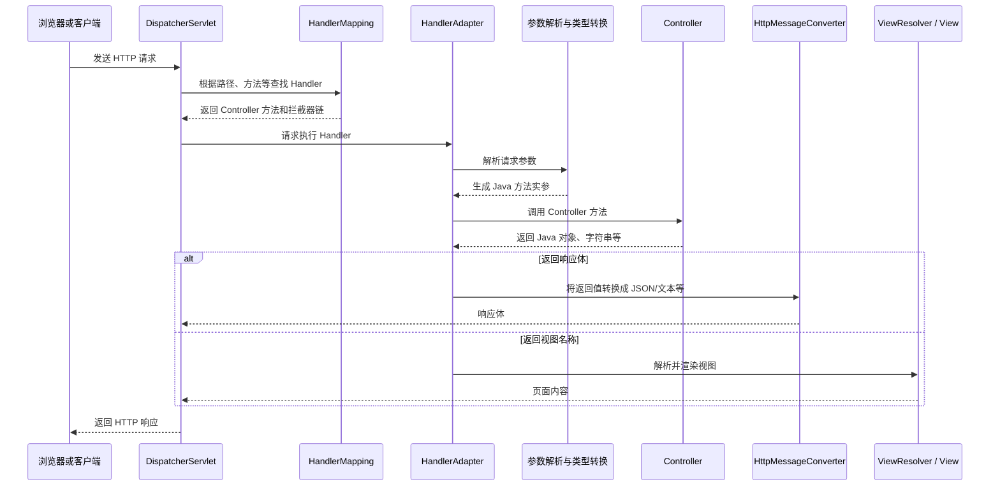

# Spring MVC 学习笔记

本文整理 Spring MVC 的请求映射、参数绑定、文件上传、响应处理及 REST API 等核心知识。

## 一、Spring MVC 是什么

Spring MVC 是 Spring 提供的 Web MVC 框架，主要负责：

- 接收 HTTP 请求；
- 根据请求路径、请求方式等条件寻找处理方法；
- 将请求参数转换为 Java 方法参数；
- 调用控制器方法；
- 将控制器的返回值转换为 HTTP 响应；
- 统一处理异常、文件上传、数据校验、视图渲染等 Web 开发问题。

MVC 的传统含义是：

- Model：模型，保存业务数据；
- View：视图，例如 Thymeleaf 页面；
- Controller：控制器，接收请求并协调业务逻辑与响应。

在前后端分离项目中，后端通常不再直接渲染 View，而是通过 Controller 返回 JSON 数据。此时 Spring MVC 仍然负责请求分发、参数绑定和响应转换。

## 二、Spring Boot 整合与依赖

Spring Boot 整合 Spring MVC 时可以引入 Web MVC starter：

```xml
<dependency>
    <groupId>org.springframework.boot</groupId>
    <artifactId>spring-boot-starter-webmvc</artifactId>
</dependency>
```

引入 Web MVC Starter 后，Spring Boot 会自动完成大量 Web 配置，例如：

- 创建并注册 `DispatcherServlet`；
- 配置内嵌 Servlet Web 服务器；
- 扫描并注册 Controller；
- 配置参数解析器和类型转换器；
- 配置 JSON 消息转换；
- 配置静态资源访问；
- 配置文件上传支持；
- 配置常见的字符编码处理。

因此，Controller 不需要自己实现 `Servlet` 接口，也不需要手动编写 `web.xml`。

启动类通常放在应用根包，例如：

```java
com.example.www.springmvchelloword
```

`@SpringBootApplication` 默认扫描启动类所在包及其子包，所以 `controller`、`bean` 等子包中的 Spring 组件可以被自动发现。

端口可以在 `application.properties` 中配置：

```properties
server.port=8888
```

应用启动后，默认访问地址是：

```text
http://localhost:8888
```

## 三、一次请求的完整处理流程

Spring MVC 的核心入口是前端控制器 `DispatcherServlet`。它本身一般不编写业务逻辑，而是协调其他组件完成请求处理。



关键组件的作用：

| 组件 | 作用 |
| --- | --- |
| `DispatcherServlet` | Spring MVC 的统一请求入口和调度中心 |
| `HandlerMapping` | 根据请求条件寻找匹配的 Controller 方法 |
| `HandlerAdapter` | 以统一方式调用不同类型的 Handler |
| 参数解析器 | 解析 `@RequestParam`、`@RequestBody`、`MultipartFile` 等参数 |
| 类型转换器 | 把请求中的字符串转换成 `int`、`boolean`、对象属性等 |
| `HttpMessageConverter` | 在 HTTP 消息体与 Java 对象之间转换，例如 JSON 与 `Person` |
| `ViewResolver` | 把逻辑视图名称解析成真正的模板页面 |
| 异常解析器 | 将 Controller 抛出的异常转换成合适的 HTTP 响应 |

## 四、Controller 与响应体

### 1. `@Controller`

`@Controller` 表示该类是 MVC 控制器。

如果方法直接返回字符串，默认会把字符串解释为“视图名称”。如果希望字符串直接写入 HTTP 响应体，需要在方法或类上添加 `@ResponseBody`：

```java
@Controller
public class HelloWorld {

    @ResponseBody
    @RequestMapping("/hello")
    String hello() {
        return "hello world";
    }
}
```

此时访问 `/hello`，响应正文就是：

```text
hello world
```

### 2. `@RestController`

`@RestController` 可以理解为：

```text
@Controller + @ResponseBody
```

类中的所有处理方法默认都将返回值写入响应体，所以更适合前后端分离接口。

```java
@RestController
public class RequestTest {
    // 方法返回值默认作为响应正文
}
```

注意：`@ResponseBody` 不代表返回值一定是 JSON。

- 返回 `String` 时，一般返回普通文本；
- 返回 Java 对象时，一般由 Jackson 转换成 JSON；
- 实际媒体类型还会受到 `produces`、客户端 `Accept` 和消息转换器影响。

## 五、请求映射 `@RequestMapping`

`@RequestMapping` 用于把 HTTP 请求映射到 Controller 类或方法。

### 1. 按路径匹配

```java
@RequestMapping("/hello")
String hello() {
    return "hello world";
}
```

路径写法应保持一致，通常统一使用以 `/` 开头的形式，虽然 Spring MVC 也接受部分不带 `/` 的写法。

类和方法可以同时配置路径：

```java
@RestController
@RequestMapping("/users")
public class UserController {

    @GetMapping("/{id}")
    public User getUser(@PathVariable Long id) {
        // ...
    }
}
```

完整路径是 `/users/{id}`。

### 2. 按 HTTP 请求方式匹配

例如只允许 POST 或 DELETE：

```java
@RequestMapping(
    value = "/test01",
    method = {RequestMethod.POST, RequestMethod.DELETE}
)
```

常用的组合注解：

| 注解 | 对应请求方式 |
| --- | --- |
| `@GetMapping` | GET |
| `@PostMapping` | POST |
| `@PutMapping` | PUT |
| `@DeleteMapping` | DELETE |
| `@PatchMapping` | PATCH |

如果路径存在，但请求方式不满足映射条件，通常会得到 `405 Method Not Allowed`。

### 3. 按请求参数匹配

```java
@RequestMapping(value = "/test02", params = "username")
```

这表示请求中必须存在 `username` 参数，例如：

```text
/test02?username=zhangsan
```

常见表达式：

```java
params = "username"          // 必须存在 username
params = "!username"         // 不能存在 username
params = "username=zhangsan" // 必须等于指定值
params = "username!=zhangsan"// 不能等于指定值
```

这里限制的是“当前方法是否能够匹配请求”，不是在方法内部执行参数校验。

### 4. 按请求头匹配

```java
@RequestMapping(value = "/test03", headers = "haha")
```

只有带有 `haha` 请求头的请求才能匹配该方法。

还可以限制具体值：

```java
headers = "X-Version=1"
```

### 5. 使用 `consumes` 限制请求体格式

```java
@RequestMapping(value = "/test04", consumes = "application/json")
```

表示该方法只接收 `Content-Type: application/json` 的请求。

需要区分：

- `Content-Type`：客户端实际发送的数据格式；
- `consumes`：Controller 声明自己能够接收的数据格式。

格式不匹配时，常见结果是 `415 Unsupported Media Type`。

`consumes` 只是映射条件，本身不会把 JSON 自动放入某个对象。要读取 JSON 数据，通常还需要使用 `@RequestBody`。

### 6. 使用 `produces` 限制响应格式

```java
@RequestMapping(
    value = "/test05",
    produces = "text/plain;charset=utf-8"
)
```

表示该方法产生普通文本响应。

需要区分：

- `Accept`：客户端希望接收的数据格式；
- `produces`：Controller 声明自己能够产生的数据格式。

如果服务器产生的格式不能满足客户端 `Accept`，可能得到 `406 Not Acceptable`。

### 7. 路径通配符

路径模式中的 `?`、`*` 和 `**` 可以先按下面的直观含义理解：

- `?`：匹配一个字符；
- `*`：匹配一个路径段中的多个字符；
- `**`：匹配多个路径层级。

多个映射同时匹配时，Spring 会通过路径具体程度比较器选择更具体的映射。通常静态、完整的路径比通配符路径优先，但不应简单地把所有情况死记成固定的 `? > * > **`；还需要考虑变量数量、通配符数量和路径长度等因素。

## 六、请求参数绑定

Spring MVC 会利用参数解析器和数据绑定机制，将 HTTP 请求中的数据转换成 Java 方法参数。

### 1. 普通简单参数

例如：

```java
@RequestMapping("handle01")
String handle01(
        String password,
        String username,
        String cellphone,
        String agreement) {
    return "ok1";
}
```

只要请求参数名与方法参数名一致，就可以完成绑定：

```text
/handle01?username=tom&password=123&cellphone=13800000000
```

需要注意：隐式使用方法参数名依赖编译产物中保留参数名。公共接口建议使用显式注解，含义更明确：

```java
@RequestParam("username") String username
```

HTML 复选框只有在选中时才会提交。未选中时，请求中通常根本没有该参数；选中但未指定 `value` 时，浏览器通常提交 `on`。

### 2. `@RequestParam`

例如：

```java
@RequestParam(value = "password", defaultValue = "123") String pwd,
@RequestParam("username") String name
```

`@RequestParam` 的主要属性：

| 属性 | 含义 |
| --- | --- |
| `value` / `name` | HTTP 请求参数名 |
| `required` | 参数是否必需，默认是 `true` |
| `defaultValue` | 参数缺失或值为空时使用的默认值 |

例如：

```java
@RequestParam(value = "page", defaultValue = "1") Integer page
```

设置 `defaultValue` 后，参数会被视为非必需参数。

### 3. JavaBean/POJO 自动封装

例如：

```java
@RequestMapping("handle03")
String handle03(Person person) {
    return "ok3";
}
```

当请求参数名和对象属性名一致时，Spring MVC 会：

1. 创建 `Person` 对象；
2. 读取请求参数；
3. 执行类型转换；
4. 调用属性的 setter；
5. 将封装完成的对象传给 Controller。

例如：

```text
username=tom&password=123&cellphone=13800000000&agreement=true
```

对象中的 `boolean agreement` 在参数缺失时会保留基本类型默认值 `false`。

复杂对象可以使用属性路径：

```text
address.province=河南省
address.city=郑州市
```

前提是根对象中确实存在 `address` 属性，并且 `Address` 类中存在相应属性和访问方法。

### 4. `@RequestHeader`

例如：

```java
@RequestHeader("host") String host
```

该参数读取 HTTP 请求头中的 `Host` 值。

也可以接收全部请求头：

```java
@RequestHeader MultiValueMap<String, String> headers
```

### 5. `@CookieValue`

例如：

```java
@CookieValue(value = "haha", required = false) String haha
```

用于获取名为 `haha` 的 Cookie。由于设置了 `required = false`，Cookie 不存在时参数值为 `null`，不会因为缺少 Cookie 直接报错。

### 6. `@RequestBody`

例如：

```java
@RequestMapping("handle07")
String handle07(@RequestBody Person person) {
    return "ok7";
}
```

`@RequestBody` 表示从 HTTP 请求体中读取数据，并通过 `HttpMessageConverter` 转换成 Java 对象。

发送 JSON 的示例：

```http
POST /handle07 HTTP/1.1
Content-Type: application/json

{
  "username": "tom",
  "password": "123",
  "cellphone": "13800000000",
  "agreement": true
}
```

需要记住两种绑定方式的区别：

| 数据来源 | 常见请求格式 | Controller 写法 |
| --- | --- | --- |
| 查询字符串或普通表单 | `?username=tom`、`application/x-www-form-urlencoded` | `String username`、`@RequestParam`、`Person person` |
| HTTP 消息体中的 JSON | `application/json` | `@RequestBody Person person` |

如果发送的是 JSON，却没有写 `@RequestBody`，Spring 通常不会按 JSON 请求体创建该对象。如果写了 `@RequestBody`，却发送普通表单，媒体类型和消息转换器也可能不匹配。

### 7. `HttpEntity<T>`

例如：

```java
@RequestMapping("handle09")
String handle09(HttpEntity<Person> httpEntity) {
    Person body = httpEntity.getBody();
    HttpHeaders headers = httpEntity.getHeaders();
    return "ok9";
}
```

`HttpEntity<T>` 同时封装：

- 请求头：`getHeaders()`；
- 请求体：`getBody()`。

它适合需要同时操作请求头和请求体的场景。它读取的是消息体，不会把 URL 查询参数自动封装进 `Person`。

如果需要进一步获得请求方法、URL 等信息，可以了解 `RequestEntity<T>`。

### 8. Servlet 原生 API

Spring MVC 方法也可以按需接收：

```java
HttpServletRequest request
HttpServletResponse response
HttpSession session
```

但普通业务接口优先使用 Spring MVC 提供的参数绑定方式，代码通常更简洁、测试也更方便。只有确实需要底层 Servlet 能力时再直接使用原生对象。

## 七、文件上传

可以使用 `MultipartFile` 接收上传文件：

```java
@RequestParam("headerImg") MultipartFile file,
@RequestParam("listImg") MultipartFile[] file1
```

HTML 表单必须满足两个条件：

```html
<form method="post" enctype="multipart/form-data">
```

- 请求方法通常使用 POST；
- `enctype` 必须是 `multipart/form-data`。

单文件对应一个 `MultipartFile`，多个同名文件可以对应 `MultipartFile[]` 或集合。

当前上传实验存在一个字段名不一致的问题：

| 位置 | 单文件字段 | 多文件字段 |
| --- | --- | --- |
| Controller | `headerImg` | `listImg` |
| `index.html` | `headerImg` | `lifeImg` |

Spring 按字段名绑定，因此页面中的 `lifeImg` 无法绑定到 Controller 要求的 `listImg`。两边必须使用相同名称。

常用 API：

```java
file.isEmpty();
file.getOriginalFilename();
file.getContentType();
file.getSize();
file.getInputStream();
file.transferTo(targetFile);
```

可以在配置文件中设置上传限制：

```properties
spring.servlet.multipart.max-file-size=10MB
spring.servlet.multipart.max-request-size=50MB
```

其中：

- `max-file-size`：单个文件的最大大小；
- `max-request-size`：一次 multipart 请求的总大小。

实际项目还应注意：

- 不要直接信任客户端提交的原始文件名；
- 防止 `../` 等路径穿越；
- 使用 UUID 等方式生成服务端文件名，避免覆盖同名文件；
- 保存前确认目录存在；
- 校验文件大小、扩展名和实际内容类型；
- 上传目录应通过配置提供，不要写死 Windows 绝对路径；
- 使用输入流后需要及时关闭，或者直接调用 `transferTo`；
- 生产环境通常将文件放在对象存储或专门文件服务中。

## 八、响应数据

### 1. 返回普通文本

```java
@GetMapping(value = "/message", produces = "text/plain;charset=UTF-8")
public String message() {
    return "成功";
}
```

在 `@RestController` 中，这个字符串会直接成为响应正文。

### 2. 返回 JSON

```java
@GetMapping("/person")
public Person person() {
    return new Person();
}
```

在 `@RestController` 中，Spring MVC 会选择合适的消息转换器，把对象序列化为 JSON。

大致过程为：

```text
Java 对象 -> HttpMessageConverter -> JSON 响应体
```

### 3. 使用 `ResponseEntity<T>`

`ResponseEntity<T>` 可以同时控制：

- HTTP 状态码；
- 响应头；
- 响应体。

```java
return ResponseEntity
        .status(HttpStatus.CREATED)
        .header("X-Result", "created")
        .body(person);
```

相比只返回一个对象，它更适合需要明确表达 REST 响应语义的接口。

### 4. 文件下载

文件下载一般需要设置：

- 响应体：文件字节或 `Resource`；
- `Content-Type`：文件媒体类型；
- `Content-Disposition`：告诉浏览器以附件形式下载，并提供文件名。

### 5. 服务端渲染和前后端分离

服务端渲染：

```text
Controller -> Model 数据 -> Thymeleaf 模板 -> 完整 HTML -> 浏览器
```

前后端分离：

```text
Controller -> JSON -> 前端 JavaScript -> 生成页面
```

服务端渲染需要引入 Thymeleaf 等模板引擎；前后端分离接口通常使用 `@RestController` 或
`@ResponseBody` 返回数据。

## 九、静态资源

`src/main/resources/static/index.html` 属于 Spring Boot 默认静态资源目录中的文件。

应用启动后，一般可以通过以下地址访问：

```text
http://localhost:8888/index.html
```

根路径 `/` 通常也会将 `index.html` 作为欢迎页。

常见静态资源目录包括：

```text
classpath:/static/
classpath:/public/
classpath:/resources/
classpath:/META-INF/resources/
```

静态资源不经过 Controller 的业务方法，但仍由 Web 应用的资源处理机制对外提供。

## 十、常见错误与排查思路

| 现象 | 常见原因 |
| --- | --- |
| 404 | 路径错误、Controller 未扫描、映射条件不满足、接口尚未实现 |
| 405 | 路径存在，但 HTTP 请求方式不允许 |
| 400 | 必需参数缺失、参数类型转换失败、请求条件不满足等 |
| 406 | 客户端 `Accept` 与接口 `produces` 不兼容 |
| 415 | 请求 `Content-Type` 与接口 `consumes` 或消息转换器不兼容 |
| 413 | 上传文件或整个请求超过服务器限制 |
| JSON 对象属性全为空 | 忘记 `@RequestBody`，或 JSON 字段名与 Java 属性名不一致 |
| 表单对象属性为空 | 表单 `name` 与 JavaBean 属性名不一致 |
| 文件参数缺失 | `<input name>` 与 `@RequestParam` 名称不一致 |
| 中文乱码 | 响应编码、媒体类型、客户端解码方式不一致 |
| 接口没有进入方法 | `method`、`params`、`headers`、`consumes`、`produces` 中某个条件不满足 |

推荐按以下顺序排查：

1. 确认应用是否启动成功以及端口是否正确；
2. 确认请求路径；
3. 确认 HTTP 方法；
4. 确认查询参数和表单字段名；
5. 确认 `Content-Type` 和 `Accept`；
6. 确认使用的是表单绑定还是 `@RequestBody`；
7. 查看控制台异常中的状态码和根本原因。

## 十一、接口测试

当前测试类使用了：

```java
@SpringBootTest
class SpringMvcHellowordApplicationTests {

    @Test
    void contextLoads() {
    }
}
```

这个测试只验证 Spring 容器能否启动，不能证明每个 MVC 接口都能正确匹配和绑定参数。

Controller 测试通常可以使用 MockMvc。例如验证 `/hello`：

```java
@SpringBootTest
@AutoConfigureMockMvc
class HelloWorldTests {

    @Autowired
    private MockMvc mockMvc;

    @Test
    void hello() throws Exception {
        mockMvc.perform(get("/hello"))
                .andExpect(status().isOk())
                .andExpect(content().string("hello world"));
    }
}
```

测试请求映射时，至少应覆盖：

- 正确路径和错误路径；
- 允许的方法和不允许的方法；
- 必需参数存在和缺失；
- 正确及错误的 `Content-Type`；
- JSON 字段绑定；
- 文件字段名和文件大小限制。

## 十二、REST API 扩展知识

### 1. REST 风格接口

使用资源名表达路径，用 HTTP 方法表达动作：

```text
GET    /books       查询图书列表
GET    /books/1     查询一本图书
POST   /books       新增图书
PUT    /books/1     整体更新图书
PATCH  /books/1     局部更新图书
DELETE /books/1     删除图书
```

路径变量使用：

```java
@GetMapping("/books/{id}")
public Book getBook(@PathVariable Long id) {
    // ...
}
```

### 2. 参数校验

实际项目中不能只完成类型转换，还需要验证业务数据：

```java
public class RegisterRequest {
    @NotBlank
    private String username;

    @Size(min = 6, max = 30)
    private String password;
}
```

Controller 中使用：

```java
public ResponseEntity<?> register(@Valid @RequestBody RegisterRequest request) {
    // ...
}
```

Web 入参通常建议使用专门的 DTO，而不是直接暴露数据库实体类。

### 3. 全局异常处理

可以使用：

```java
@RestControllerAdvice
public class GlobalExceptionHandler {

    @ExceptionHandler(BusinessException.class)
    public ResponseEntity<?> handleBusinessException(BusinessException ex) {
        // ...
    }
}
```

这样可以统一处理业务异常、校验异常和系统异常，避免每个 Controller 重复编写 `try-catch`。

### 4. 分层职责

推荐职责划分：

```text
Controller：HTTP 协议适配、参数接收、返回响应
Service：业务逻辑和事务
Repository/Mapper：数据访问
DTO：请求和响应数据结构
Entity：数据库实体
```

Controller 应保持轻量，不要把大量业务逻辑、数据库操作和文件存储细节全部写在 Controller 中。

## 十三、核心知识总结

1. Spring MVC 的核心入口是 `DispatcherServlet`，Controller 只是请求处理链中的一环。
2. `@Controller` 用于 MVC 控制器，`@RestController` 更适合直接返回 JSON 或文本。
3. `@RequestMapping` 不只匹配路径，还能限制方法、参数、请求头、请求格式和响应格式。
4. 查询参数、普通表单、JSON 请求体和 multipart 文件属于不同的数据来源，绑定方式也不同。
5. `@RequestParam` 读取请求参数，`@RequestBody` 读取请求体，`@RequestHeader` 读取请求头，`@CookieValue` 读取 Cookie。
6. JavaBean 自动封装要求请求字段名与对象属性名对应，嵌套对象使用 `address.city` 形式。
7. JSON 与 Java 对象之间的转换由 `HttpMessageConverter` 完成。
8. 文件上传要求 `multipart/form-data`，表单字段名必须与 Controller 参数名一致。
9. `ResponseEntity` 可以精确控制响应状态码、响应头和响应体。
