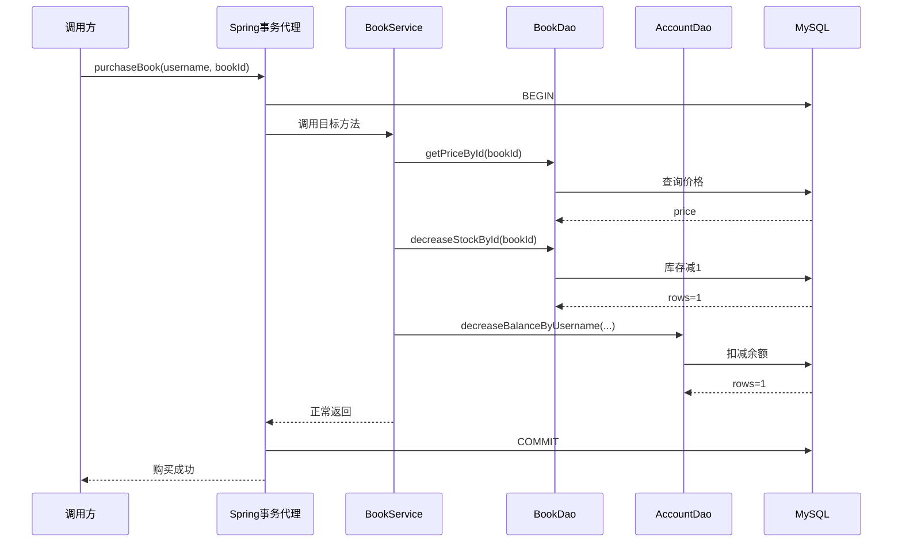
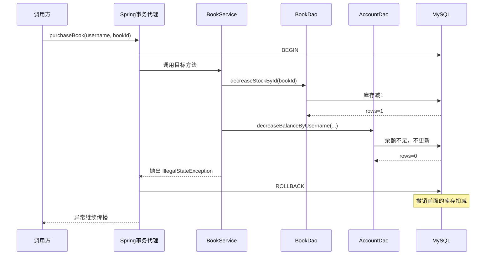

# Spring JDBC 与事务学习笔记

本文重点整理数据库连接、`JdbcTemplate`、声明式事务、回滚规则、事务传播、隔离级别和并发场景。

## 1. 事务业务示例

以图书购买业务中的两张表为例：

- `book`：保存图书名称、价格和库存；
- `account`：保存用户名、年龄和账户余额。

可以围绕它们练习：

1. 查询图书；
2. 新增图书；
3. 按 ID 修改图书库存；
4. 按 ID 删除图书；
5. 按用户名扣减账户余额；
6. 编写“用户购买图书”的完整事务方法。

购买一本图书包含两个核心写操作：

```text
图书库存减 1
账户余额减去图书价格
```

这两个操作必须保持一致：不能只扣库存不扣余额，也不能只扣余额不扣库存。因此，它们应被放进同一个事务。

## 2. 分层结构与职责

```text
应用
├── bean
│   ├── Book.java                图书数据对象
│   └── Account.java             账户数据对象
├── dao
│   ├── BookDao.java             图书表数据库操作
│   └── AccountDao.java          账户表数据库操作
├── service
│   └── BookService.java         购买图书的事务边界
├── SpringTxApplication.java     Spring Boot 启动类
├── application.properties       数据源配置
└── SpringTxApplicationTests.java 数据库和事务测试
```

职责划分：

- Bean：承载数据；
- DAO：执行单条或单类 SQL；
- Service：组织完整业务流程，并定义事务边界；
- Test：验证数据库操作、业务结果和事务行为。

事务通常应该放在 Service 层，因为 Service 方法表达的是一个完整业务动作。单个 DAO 方法只负责一条数据库操作，不知道整个业务什么时候才算成功。

## 3. 数据库依赖

常用的主要依赖是：

```xml
<dependency>
    <groupId>org.springframework.boot</groupId>
    <artifactId>spring-boot-starter-data-jdbc</artifactId>
</dependency>

<dependency>
    <groupId>com.mysql</groupId>
    <artifactId>mysql-connector-j</artifactId>
    <scope>runtime</scope>
</dependency>
```

两者职责不同：

| 依赖 | 作用 |
| --- | --- |
| `spring-boot-starter-data-jdbc` | 提供 Spring JDBC、`JdbcTemplate`、事务支持、数据源自动配置，以及 Spring Data JDBC 能力 |
| `mysql-connector-j` | 提供真正与 MySQL 通信的 JDBC 驱动 |

只引入 Spring JDBC 不能连接 MySQL，因为它没有实现 MySQL 通信协议；只引入 MySQL 驱动则缺少 Spring 提供的模板、自动配置和事务抽象。

如果只使用 `JdbcTemplate` 而不使用 Spring Data JDBC Repository，也可以选择更轻量的：

```xml
<artifactId>spring-boot-starter-jdbc</artifactId>
```

`spring-boot-starter-data-jdbc` 也包含所需的 JDBC 基础能力，但会额外引入 Spring Data JDBC。

## 4. 数据源配置

典型 MySQL 配置如下：

```properties
spring.datasource.url=jdbc:mysql://localhost:3306/数据库名
spring.datasource.username=用户名
spring.datasource.password=密码
spring.datasource.driver-class-name=com.mysql.cj.jdbc.Driver
```

配置含义：

| 配置项 | 含义 |
| --- | --- |
| `url` | 数据库协议、主机、端口和数据库名 |
| `username` | 登录数据库的用户名 |
| `password` | 登录密码 |
| `driver-class-name` | JDBC 驱动类 |

使用 MySQL Connector/J 时，Spring Boot 通常可以根据 `jdbc:mysql:` 自动推断驱动类，因此 `driver-class-name` 可以省略。

### 4.1 常见配置错误

错误主机名：

```properties
spring.datasource.url=jdbc:mysql://locahost:3306/ssm-test
```

正确拼写是：

```properties
spring.datasource.url=jdbc:mysql://localhost:3306/ssm-test
```

驱动依赖和驱动类也必须对应：

```text
MySQL URL      -> mysql-connector-j -> com.mysql.cj.jdbc.Driver
MariaDB URL    -> mariadb-java-client -> org.mariadb.jdbc.Driver
```

不能一边引入 MariaDB 驱动，一边显式配置 MySQL 驱动类，否则会出现找不到驱动类或协议不匹配。

### 4.2 生产环境注意事项

- 不要把真实密码提交到代码仓库；
- 可以通过环境变量、配置中心或密钥管理系统提供凭据；
- 应区分开发、测试和生产环境配置；
- 数据库账号只授予应用真正需要的权限。

## 5. DataSource、连接池与 JdbcTemplate

### 5.1 DataSource

`DataSource` 是获取数据库连接的统一接口：

```java
Connection connection = dataSource.getConnection();
```

使用 Spring Boot 默认连接池时，常见连接包装类型是：

```text
com.zaxxer.hikari.pool.HikariProxyConnection
```

这说明获取到的不是直接裸建的 MySQL 连接，而是 HikariCP 连接池包装后的连接。

连接池会复用数据库连接，避免每次 SQL 都重新完成网络连接和身份认证。业务代码关闭连接时，通常是把连接归还到连接池，而不是彻底关闭底层物理连接。

直接获取连接时应及时关闭：

```java
try (Connection connection = dataSource.getConnection()) {
    System.out.println(connection.getClass());
}
```

### 5.2 JdbcTemplate

`JdbcTemplate` 对 JDBC 的重复代码进行了封装，负责：

- 获取和释放连接；
- 创建 `PreparedStatement`；
- 绑定参数；
- 执行 SQL；
- 转换 JDBC 异常；
- 在事务环境中复用当前事务连接。

更新操作：

```java
int rows = jdbcTemplate.update(sql, parameter1, parameter2);
```

返回值 `rows` 是受影响行数：

- `1`：成功更新一行；
- `0`：没有记录满足条件；
- 大于 `1`：更新了多行，应检查 SQL 是否符合预期。

查询单个对象：

```java
Book book = jdbcTemplate.queryForObject(
    "select * from book where id = ?",
    new BeanPropertyRowMapper<>(Book.class),
    id
);
```

`BeanPropertyRowMapper` 按列名和 JavaBean 属性名进行映射。如果表字段使用 `bookName`，新增 SQL 也必须使用真实字段名：

```sql
insert into book(bookName, price, stock) values (?, ?, ?)
```

不能仅根据 Java 属性名习惯推断数据库一定使用 `book_name`；应以实际表结构为准。

### 5.3 JdbcTemplate 必须由 Spring 注入

下面只声明字段但不注入，会导致 `jdbcTemplate == null`：

```java
JdbcTemplate jdbcTemplate;
```

调用时会出现 `NullPointerException`。

可以使用字段注入：

```java
@Autowired
JdbcTemplate jdbcTemplate;
```

更推荐构造器注入：

```java
private final JdbcTemplate jdbcTemplate;

public BookDao(JdbcTemplate jdbcTemplate) {
    this.jdbcTemplate = jdbcTemplate;
}
```

构造器注入能够保证对象创建完成后依赖一定存在，也更方便单元测试。

## 6. DAO 操作示例

### 6.1 查询图书

```sql
select * from book where id = ?
```

`queryForObject` 要求结果恰好是一行。没有结果或返回多行时都会抛异常，因此真实业务中需要决定：

- 没有图书时返回 `null` 或 `Optional`；
- 还是抛出明确的“图书不存在”业务异常。

### 6.2 新增图书

```sql
insert into book(bookName, price, stock) values (?, ?, ?)
```

参数通过占位符传入，不要使用字符串拼接 SQL，这既可以正确处理类型，也有助于防止 SQL 注入。

### 6.3 按 ID 修改库存

```sql
update book set stock = ? where id = ?
```

这是把库存直接修改成指定值，适合管理员调整库存。

### 6.4 按 ID 删除图书

```sql
delete from book where id = ?
```

真实系统还可能采用逻辑删除，即更新 `deleted` 状态，而不是物理删除数据。

### 6.5 购买时扣减库存

```sql
update book
set stock = stock - 1
where id = ? and stock > 0
```

这条 SQL 把“判断库存”和“扣减库存”合成一个数据库原子操作。受影响行数为 `0` 时，说明图书不存在或库存不足。

相比以下写法，它更适合并发环境：

```text
先查询库存
Java 判断库存大于 0
再把库存写回数据库
```

因为在查询和写回之间，其他事务可能已经修改库存。

### 6.6 按用户名扣减余额

```sql
update account
set balance = balance - ?
where username = ? and balance >= ?
```

同样把“余额校验”和“扣减余额”合并成一个原子操作。返回 `0` 表示用户不存在或余额不足。

金额使用 `BigDecimal`，不使用 `double`，是为了避免二进制浮点数的精度误差。

## 7. 什么是事务

事务是数据库中的一个逻辑工作单元。事务内的一组操作要么全部成功并提交，要么在失败时全部撤销。

以购买图书为例：

```text
开始事务
  ├─ 查询图书价格
  ├─ 库存减 1
  ├─ 余额减去图书价格
  ├─ 全部成功：COMMIT
  └─ 任一步失败：ROLLBACK
```

如果库存已经减少，但余额扣减失败，没有事务时数据库会留下不一致状态。事务回滚可以撤销本次事务已经完成的库存修改。

### 7.1 ACID 四个特性

#### 原子性 Atomicity

事务中的操作是不可分割的整体：全部成功或全部失败。

#### 一致性 Consistency

事务执行前后，数据应满足数据库约束和业务规则，例如库存、余额不能出现不允许的状态。

一致性是目标，数据库约束、正确 SQL、事务以及业务校验共同实现这个目标。

#### 隔离性 Isolation

多个事务并发执行时，彼此未完成的中间状态应按照隔离级别受到限制。

#### 持久性 Durability

事务提交后，修改应被可靠保存，即使数据库随后重启也不应丢失。

## 8. 购买图书事务

当前事务入口位于 `BookService.purchaseBook()`：

```java
@Transactional
public void purchaseBook(String username, Integer bookId) {
    BigDecimal price = bookDao.getPriceById(bookId);

    int stockRows = bookDao.decreaseStockById(bookId);
    if (stockRows == 0) {
        throw new IllegalStateException("图书不存在或库存不足");
    }

    int accountRows = accountDao.decreaseBalanceByUsername(username, price);
    if (accountRows == 0) {
        throw new IllegalStateException("用户不存在或余额不足");
    }
}
```

### 8.1 正常提交时序



### 8.2 余额不足时序



## 9. Spring 声明式事务原理

`@Transactional` 本身不会直接执行提交或回滚。Spring 通过 AOP 代理在业务方法外层增加事务逻辑：

```text
调用方
  ↓
事务代理 / TransactionInterceptor
  ├─ 获取事务管理器
  ├─ 开启或加入事务
  ├─ 调用 BookService.purchaseBook()
  ├─ 正常返回：提交
  └─ 满足回滚规则的异常：回滚
```

关键组件：

| 组件 | 作用 |
| --- | --- |
| `TransactionManager` | 事务管理抽象，负责获取、提交和回滚事务 |
| `JdbcTransactionManager` | JDBC 场景中常用的事务管理器实现 |
| `TransactionInterceptor` | 事务 AOP 拦截器，决定何时提交或回滚 |
| `@Transactional` | 描述事务属性和边界 |

同一事务中的多个 `JdbcTemplate` 操作必须使用同一个数据源和事务管理器，Spring 才能把它们绑定到同一个数据库连接和事务中。

## 10. 为什么通常不用手写 @EnableTransactionManagement

传统 Spring 配置中可以显式添加：

```java
@EnableTransactionManagement
```

在 Spring Boot 项目中，只要事务相关依赖、数据源和事务管理器自动配置正常，Boot 会自动启用事务基础设施，因此 `@Transactional` 可以直接生效。

显式添加 `@EnableTransactionManagement` 通常不会破坏功能，但在常规 Spring Boot 单数据源项目中属于重复声明。

以下场景可能需要显式配置：

- 使用纯 Spring 而不是 Spring Boot；
- 禁用了事务自动配置；
- 需要定制代理模式或选择特定事务管理器；
- 项目有多个数据源和多个事务管理器，需要明确指定关系。

## 11. 必须手动 throw 才会回滚吗

不要求一定手写 `throw`，但事务拦截器通常需要观察到符合回滚规则的异常从事务方法向外传播。

### 11.1 数据库或程序自然抛出异常

例如 SQL 语法错误、唯一键冲突、连接失败或 `ArithmeticException`，只要异常继续向外传播并满足回滚规则，Spring 就会回滚，不需要额外手写一次 `throw`。

### 11.2 业务失败不会自然抛异常

条件更新库存不足时：

```java
int rows = jdbcTemplate.update(...);
```

SQL 本身执行成功，只是返回 `rows == 0`。如果方法随后正常返回，Spring 会认为业务成功并提交事务。

因此需要把业务失败转换成异常：

```java
if (rows == 0) {
    throw new IllegalStateException("库存不足");
}
```

这里手动抛异常的目的不是“事务只能识别 throw 语句”，而是让事务代理知道业务没有成功完成。

### 11.3 吞掉异常可能导致事务提交

```java
@Transactional
public void purchaseBook(...) {
    try {
        // 数据库操作
    } catch (Exception exception) {
        System.out.println("购买失败");
    }
}
```

异常被捕获后方法正常返回，事务代理可能提交事务。通常应继续抛出：

```java
catch (Exception exception) {
    throw new IllegalStateException("购买失败", exception);
}
```

也可以手动把当前事务标记为只能回滚，但这会让业务代码直接依赖 Spring 事务 API，通常不如抛出明确业务异常清晰。

### 11.4 默认回滚规则

默认回滚：

- `RuntimeException` 及其子类；
- `Error` 及其子类。

默认不回滚受检异常，例如普通 `Exception`、`IOException`。需要时可以指定：

```java
@Transactional(rollbackFor = Exception.class)
```

也可以排除某种异常：

```java
@Transactional(noRollbackFor = SomeException.class)
```

`rollbackFor` 应根据业务语义配置，不应为了“保险”无差别捕获并包装所有问题。

## 12. @Transactional 常用属性

```java
@Transactional(
    propagation = Propagation.REQUIRED,
    isolation = Isolation.READ_COMMITTED,
    timeout = 10,
    readOnly = false,
    rollbackFor = Exception.class
)
```

| 属性 | 作用 |
| --- | --- |
| `propagation` | 当前方法与已有事务如何组合 |
| `isolation` | 并发事务之间的数据可见性 |
| `timeout` | 事务允许执行的时间限制 |
| `readOnly` | 声明事务主要执行读取，供框架和数据库优化 |
| `rollbackFor` | 额外指定需要回滚的异常 |
| `noRollbackFor` | 指定不需要回滚的异常 |

事务超时从事务开始后计算，由事务管理器应用到事务及相关语句。它不应简单理解为“从方法开始到最后一次 DAO 调用结束”的固定秒表，不同事务管理器和数据库驱动的执行细节可能不同。

`readOnly = true` 是只读提示和优化手段，不应把它当作绝对安全权限控制；是否严格禁止写入取决于事务管理器和数据库。

## 13. 事务传播行为

事务传播行为（Propagation）描述的是：一个事务方法调用另一个事务方法时，被调用方法应该加入当前事务、创建新事务，还是以非事务方式执行。

传播行为讨论的是事务方法之间如何组合，不是多个用户并发访问时的数据可见性。两者区别如下：

```text
传播行为：多个嵌套事务方法之间如何组合
隔离级别：多个并发事务之间能够看到什么数据
```

例如：

```java
@Transactional
public void purchaseBook() {
    decreaseStock();
    decreaseBalance();
}
```

如果 `decreaseStock()` 和 `decreaseBalance()` 也带有 `@Transactional`，就需要决定这三个方法是共用一个事务，还是分别创建事务。这个决定由 `propagation` 控制。

### 13.1 七种传播行为总览

| 传播行为 | 当前存在事务 | 当前不存在事务 |
| --- | --- | --- |
| `REQUIRED` | 加入当前事务 | 创建新事务 |
| `REQUIRES_NEW` | 挂起当前事务，创建独立新事务 | 创建新事务 |
| `SUPPORTS` | 加入当前事务 | 以非事务方式执行 |
| `NOT_SUPPORTED` | 挂起当前事务，以非事务方式执行 | 以非事务方式执行 |
| `MANDATORY` | 加入当前事务 | 抛出异常 |
| `NEVER` | 抛出异常 | 以非事务方式执行 |
| `NESTED` | 创建嵌套事务或保存点 | 创建新事务 |

### 13.2 REQUIRED

`REQUIRED` 是默认传播行为：

```text
外部已有事务 -> 加入外部事务
外部没有事务 -> 创建新事务
```

例如购买流程中的方法都采用 `REQUIRED`：

```text
purchaseBook 事务
├── decreaseStock 加入 purchaseBook 事务
└── decreaseBalance 加入 purchaseBook 事务
```

它们共用同一个事务：

```text
BEGIN
  扣减库存
  扣减余额
COMMIT
```

任一步发生满足回滚规则的异常，整个事务一起回滚。这最符合“库存和余额必须同时成功”的购买业务。

当前 `BookService.purchaseBook()` 没有显式指定 `propagation`，所以使用的就是 `REQUIRED`：

```java
@Transactional // propagation 默认为 Propagation.REQUIRED
public void purchaseBook(String username, Integer bookId) {
}
```

### 13.3 REQUIRES_NEW

无论外部是否有事务，都创建独立新事务；有外部事务时先挂起外部事务。

例如希望购买失败时仍然保存一条失败日志：

```java
@Transactional(propagation = Propagation.REQUIRES_NEW)
public void saveFailureLog() {
}
```

调用结构：

```text
购买事务
├── 扣减库存
├── 暂停购买事务
│   └── 开启日志事务
│       └── 保存日志并独立提交
├── 恢复购买事务
└── 购买事务回滚
```

最终可能出现：

```text
购买数据：回滚
日志数据：已经提交
```

这适合确实需要独立提交的数据，但也会打破“所有操作一起回滚”的整体性，必须符合业务设计。

### 13.4 REQUIRED 与 REQUIRES_NEW 对比

`REQUIRED` 共用事务：

```text
外层事务
├── 方法 A
└── 方法 B
```

方法 B 失败，外层事务通常也需要回滚。

`REQUIRES_NEW` 使用独立事务：

```text
外层事务
├── 方法 A
├── 暂停外层事务
│   └── 方法 B 的独立事务
└── 恢复外层事务
```

方法 B 可以独立提交或回滚，不直接依赖外层事务最终是否提交。

### 13.5 SUPPORTS

外部有事务就加入，没有事务就以非事务方式执行。

它适合能够参与事务但不强制要求事务的操作，例如某些普通查询。不过是否使用事务仍应根据一致性要求决定。

### 13.6 NOT_SUPPORTED

以非事务方式执行；如果外部存在事务，就先挂起外部事务。

它与 `SUPPORTS` 不同：`SUPPORTS` 在有事务时会加入，而 `NOT_SUPPORTED` 即使外层有事务也会将其挂起。

### 13.7 MANDATORY

必须在已有事务中执行；外部没有事务时直接报错。

它适合规定某个底层操作不能独立执行，必须属于一个上层完整事务的场景。

### 13.8 NEVER

要求当前不存在事务；如果外部已有事务则报错。

它与 `NOT_SUPPORTED` 的区别是：

```text
NOT_SUPPORTED：有事务就暂时挂起
NEVER：有事务直接拒绝执行
```

### 13.9 NESTED

在支持保存点的事务管理器中创建嵌套事务。嵌套事务可以回滚到保存点，而不一定让整个外部事务立即回滚。它与 `REQUIRES_NEW` 的独立物理事务不同。

```text
外部事务
├── 执行操作 A
├── 创建保存点
├── 执行嵌套操作 B
├── B 失败时回滚到保存点
└── 外部事务决定继续还是整体回滚
```

如果外部事务最终回滚，嵌套事务的操作也会一起回滚。`NESTED` 是否可用取决于事务管理器和数据库是否支持保存点。

### 13.10 事务测试中的传播过程

假设测试方法本身带有 `@Transactional`，而被调用的 `purchaseBook()` 使用默认的 `REQUIRED`：

```text
测试框架开启测试事务
  ↓
testPurchaseBook()
  ↓
purchaseBook() 加入已有测试事务
  ↓
BookDao 与 AccountDao 使用同一事务连接
  ↓
测试结束，测试框架默认回滚
```

因此测试执行期间可以查询到库存和余额已经变化，但测试结束后这些修改不会永久保留。

### 13.11 回滚只读标记与 UnexpectedRollbackException

当内部 `REQUIRED` 方法加入外部事务后，它们使用的是同一个事务。如果内部方法发生异常并把事务标记为 `rollback-only`，外层即使捕获异常并继续正常返回，最终提交时仍可能出现 `UnexpectedRollbackException`。

```text
内部方法：事务已标记为只能回滚
外层方法：捕获异常后继续执行
外层提交：发现 rollback-only，只能回滚并报告异常
```

所以不能简单认为“外层把异常 catch 住，事务就一定能提交”。共享事务一旦被标记为只能回滚，后续无法恢复成可提交状态。

### 13.12 传播行为的代理限制

传播行为必须经过 Spring 事务代理才能被解释。同一个类内部使用 `this` 调用时通常会绕过代理：

```java
public void outer() {
    this.inner();
}

@Transactional(propagation = Propagation.REQUIRES_NEW)
public void inner() {
}
```

这里 `inner()` 的 `REQUIRES_NEW` 可能不会生效，因为调用没有进入 Spring 代理。常见做法是把 `inner()` 放入另一个 Spring Bean，再通过注入的 Bean 调用。

### 13.13 选择要点

- 普通完整业务流程优先使用默认的 `REQUIRED`；
- 只有确实需要独立提交时才使用 `REQUIRES_NEW`；
- 使用 `NESTED` 前确认事务管理器和数据库的保存点支持；
- 不要为了“看起来安全”随意组合传播行为；
- 先明确哪些操作必须一起成功，再决定它们应该共享还是拆分事务。

## 14. 事务隔离级别

隔离级别规定多个事务同时执行时，一个事务可以看到另一个事务的哪些变化。

### 14.1 常见并发问题

#### 脏读

事务 A 读到了事务 B 尚未提交的数据，随后事务 B 回滚，导致事务 A 读到一个从未真正生效的值。

#### 不可重复读

同一个事务内两次读取同一行，期间另一个事务修改并提交，导致两次结果不同。

#### 幻读

同一个事务内两次按相同条件查询，期间另一个事务新增或删除符合条件的行，导致结果集行数发生变化。

#### 丢失更新

两个事务都读取旧值，各自计算后写回，后一次写入覆盖前一次结果，导致其中一次业务修改丢失。

丢失更新通常需要通过原子 SQL、悲观锁、乐观锁等方式处理，不能只靠“避免脏读”解决。

### 14.2 四种标准隔离级别

| 隔离级别 | 脏读 | 不可重复读 | 幻读 | 并发能力 |
| --- | --- | --- | --- | --- |
| `READ_UNCOMMITTED` | 可能 | 可能 | 可能 | 高 |
| `READ_COMMITTED` | 避免 | 可能 | 可能 | 较高 |
| `REPEATABLE_READ` | 避免 | 避免 | 取决于数据库实现和访问方式 | 较低 |
| `SERIALIZABLE` | 避免 | 避免 | 避免 | 最低 |

隔离级别越高，一般意味着等待、锁竞争或版本管理成本越高。并不是所有业务都应该直接使用最高隔离级别。

Spring 中可以配置：

```java
@Transactional(isolation = Isolation.READ_COMMITTED)
```

默认值：

```java
Isolation.DEFAULT
```

表示沿用当前数据库配置的默认隔离级别。

## 15. READ_COMMITTED 与现实中的两人并发

`READ_COMMITTED` 能阻止脏读，因为它只允许读取其他事务已经提交的数据。

假设初始余额为 1000：

| 时间 | 事务 A | 事务 B |
| --- | --- | --- |
| T1 | 把余额改为 500，尚未提交 |  |
| T2 |  | 查询余额 |
| T3 | 事务未提交 | B 仍读取到已提交的 1000，而不是 500 |
| T4 | 提交 |  |
| T5 |  | 再次查询，读取到 500 |

因此它防止了脏读，但事务 B 在同一事务中两次读取结果可能不同，这属于不可重复读。

### 15.1 READ_COMMITTED 不自动防止超卖

错误的“先查再改”方式：

```text
初始库存 = 1

事务 A 查询库存 -> 1
事务 B 查询库存 -> 1
事务 A 判断可购买并写入 0
事务 B 也根据旧值判断可购买
```

即使看不到未提交数据，也不代表业务判断不会基于过期数据。

采用原子条件更新：

```sql
update book
set stock = stock - 1
where id = ? and stock > 0
```

典型并发过程：

```text
事务 A 更新成功，锁定目标行，rows = 1
事务 B 更新同一行时等待
事务 A 提交，库存变为 0
事务 B 继续执行并重新判断 stock > 0
条件不成立，rows = 0
事务 B 抛出库存不足异常并回滚
```

这说明：

```text
隔离级别负责并发事务的数据可见性
条件 UPDATE 负责库存和余额的业务约束
事务负责多个操作要么一起提交，要么一起回滚
```

三者解决的问题不同，需要组合使用。

## 16. 其他并发控制手段

### 16.1 悲观锁

查询时锁定记录：

```sql
select stock from book where id = ? for update
```

其他事务修改同一行时需要等待。适合冲突概率高、必须严格串行处理的场景，但锁持有时间过长会降低吞吐量。

### 16.2 乐观锁

表中增加版本号：

```sql
update book
set stock = ?, version = version + 1
where id = ? and version = ?
```

受影响行数为 `0` 表示期间已被其他事务修改，可选择重试或提示冲突。适合读多写少、冲突概率较低的场景。

### 16.3 唯一约束

例如一个请求号只能成功购买一次，应在数据库中建立唯一约束。只依赖 Java 中“先查是否存在”仍可能在并发下插入重复数据。

## 17. @Transactional 的代理限制

Spring 声明式事务基于 AOP 代理，因此还需要满足代理调用条件。

### 17.1 对象必须由 Spring 管理

```java
BookService service = new BookService(...);
service.purchaseBook(...);
```

手动 `new` 出来的对象没有经过 Spring 代理，`@Transactional` 不会自动生效。

### 17.2 调用需要经过代理

同一个类中的自调用通常绕过代理：

```java
public void outer() {
    this.purchaseBook(...);
}
```

即使 `purchaseBook()` 带有 `@Transactional`，这次调用也可能没有进入事务拦截器。常见解决方式是把事务方法放到独立 Bean 中，通过 Bean 之间调用。

### 17.3 方法可代理性

常规实践是把事务放在 Spring Bean 的 `public` 方法上。`private` 方法无法通过外部代理调用；CGLIB 也不能覆盖 `final` 方法。

### 17.4 异步和新线程

事务上下文通常绑定在线程上。在事务方法中创建新线程或切换到异步执行后，新线程不会自动继承原事务。

## 18. 测试中的事务

当前新增、修改、删除、扣余额和购买测试都标注了：

```java
@Test
@Transactional
```

Spring 测试框架默认会在测试结束后回滚测试事务，因此可以验证数据库写操作，又不会永久改变本地数据。

调用关系：

```text
测试框架开启测试事务
  ↓
调用 BookService.purchaseBook()
  ↓
purchaseBook 使用默认 REQUIRED，加入现有测试事务
  ↓
断言修改结果
  ↓
测试结束，测试框架回滚
```

这与生产调用不同：生产环境中如果方法正常返回，事务代理会提交；测试回滚是测试框架为了保持数据环境干净而提供的行为。

### 18.1 事务测试应验证失败路径

只验证成功购买还不足以证明回滚正确。更完整的测试应验证：

1. 余额不足时购买抛出异常；
2. 抛异常后库存保持不变；
3. 库存不足时余额保持不变；
4. 正常购买时库存和余额同时变化。

如果测试方法本身处在一个外层回滚事务中，需要注意它可能掩盖对 Service 自身提交行为的验证。验证提交边界时，可以设计独立集成测试或显式控制测试事务。

## 19. 常见故障与排查

### 数据源创建失败

- JDBC URL 主机名是否拼错；
- 端口是否正确；
- 数据库服务是否启动；
- 数据库名是否存在；
- 用户名和密码是否正确；
- 驱动依赖是否与 URL、驱动类匹配；
- Maven 是否已经重新加载依赖。

### JdbcTemplate 调用空指针

- DAO 是否由 Spring 管理；
- `JdbcTemplate` 是否完成注入；
- 是否手动 `new` 了 DAO；
- 是否建议改用构造器注入。

### BadSqlGrammarException

查看最底层数据库异常，不要只看 Spring 外层异常。常见原因：

- 表名或字段名错误；
- 实际列名是 `bookName`，SQL 却写成 `book_name`；
- 占位符数量和参数数量不一致；
- 使用了当前数据库不支持的语法。

### 事务没有回滚

- 方法是否通过 Spring 代理调用；
- 异常是否被捕获后吞掉；
- 抛出的是不是默认不回滚的受检异常；
- `@Transactional` 是否放在合适的 Service 方法；
- 是否发生同类自调用；
- 数据表是否使用支持事务的存储引擎；
- 多个 DAO 是否使用同一个事务管理器和数据源。

### 并发后库存或余额错误

- 是否采用“先查询、Java 计算、再覆盖写入”；
- 是否使用带条件的原子 UPDATE；
- 是否检查 `update()` 返回的受影响行数；
- 是否需要乐观锁、悲观锁或唯一约束；
- 是否错误地认为提高隔离级别就能替代业务并发控制。

## 20. 知识要点总结

1. Spring JDBC 和数据库驱动缺一不可，驱动必须与 JDBC URL 对应。
2. `JdbcTemplate` 简化连接管理、参数绑定、SQL 执行和异常转换。
3. DAO 负责数据库操作，Service 负责完整业务流程和事务边界。
4. 事务保证一组操作一起提交或一起回滚，核心特性是 ACID。
5. `@Transactional` 通过 Spring AOP 事务代理实现。
6. Spring Boot 通常自动启用事务，不必重复添加 `@EnableTransactionManagement`。
7. 默认遇到运行时异常和 `Error` 回滚，受检异常需要额外配置。
8. 业务失败如果只表现为 `rows == 0`，需要转换为异常或明确标记回滚。
9. 捕获并吞掉异常可能让事务代理误以为方法成功，从而提交事务。
10. `READ_COMMITTED` 能避免脏读，但不能自动避免不可重复读、幻读或业务超卖。
11. 库存和余额应使用带条件的原子 SQL，并检查受影响行数。
12. `@Transactional` 受代理边界限制，手动创建对象和同类自调用是常见失效原因。
13. 测试上的 `@Transactional` 默认在测试结束后回滚，与生产正常提交不同。
14. 隔离级别、原子 SQL、数据库约束和事务各自解决不同问题，需要组合设计。
